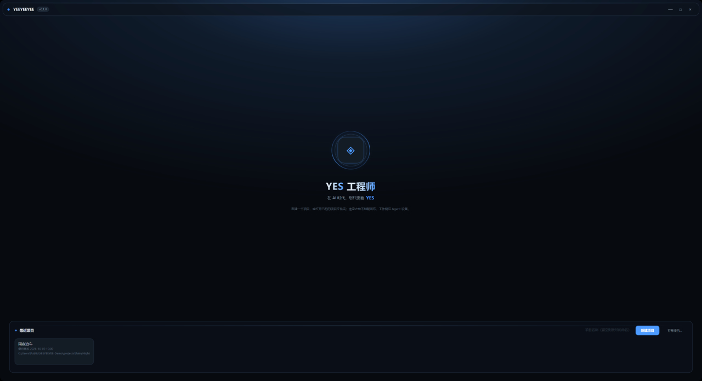
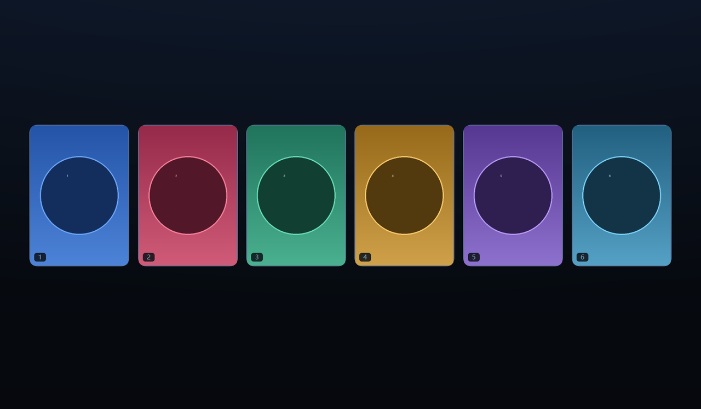
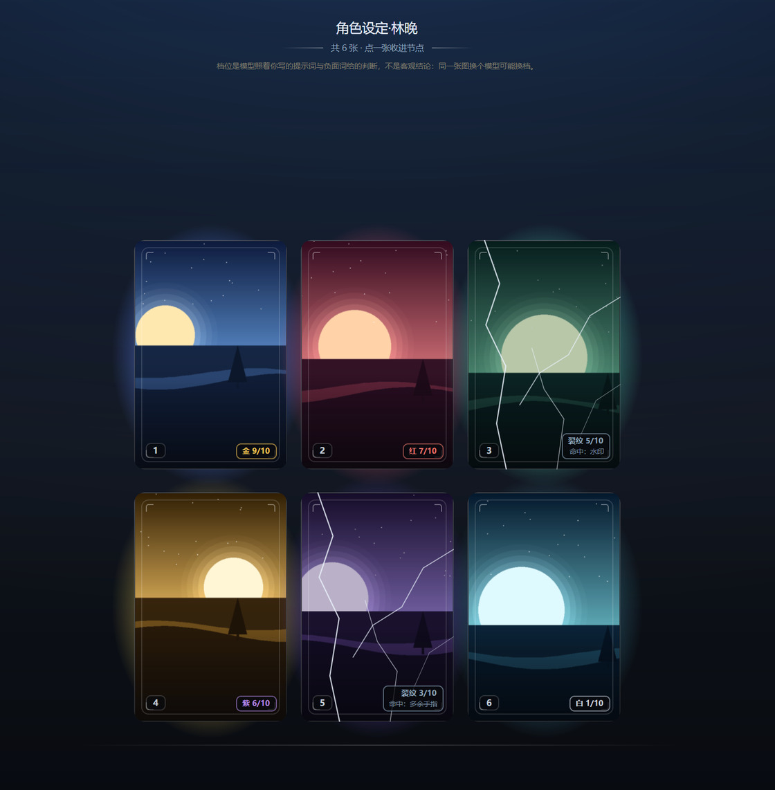

# YEEYEEYEE

> 面向 AI 创作的 Windows 桌面工作区与 Web 协作服务

[](https://github.com/Cybeta/YEEYEEYEE/actions/workflows/build.yml)

YEEYEEYEE 把 **企划、章节、分镜、图片、视频和成片** 放在同一个项目里。角色、道具和场景作为设定被分镜引用，设定更新后提示受影响内容。当前源码版本为 **0.1.5.5**；发行状态以 [GitHub Releases](https://github.com/Cybeta/YEEYEEYEE/releases) 为准。

## 界面预览

<p align="center">
  
  
  
</p>

## 快速开始

### 下载运行

从[最新发行版](https://github.com/Cybeta/YEEYEEYEE/releases/latest)下载 `win-x64.zip`，解压运行 `YEEYEEYEE.Desktop.Avalonia.exe`。需要 Windows、.NET 10 运行时和 Microsoft Edge WebView2 Runtime。建议放在可写目录，应用内更新需要替换程序文件。

`0.1.5.4` 及更早的便携安装如果程序旁有 `Projects`、配置或密钥，请先按 [Desktop 进度与待办](docs/Desktop进度与待办.md#0154-首次升级与手动迁移) 手动迁移，不要直接点应用内升级。

### 从源码运行

需要 Windows 和 .NET 10 SDK：

```powershell
dotnet build YEEYEEYEE.slnx
dotnet run --project YEEYEEYEE.Desktop.Avalonia
```

### 配置模型

在设置页填写聊天、图像和视频服务地址、模型和密钥。密钥按平台保存，不能把配置文件当成可跨机器迁移的凭据；加密不可用时应检查界面提示。判图质量需要支持图片输入的模型。也可接入本地或远程 ComfyUI。

## 核心能力

- 项目文件夹管理画布、素材、技能和工作流；企划、章节、分镜和成品按阶段组织。
- 角色、道具、场景支持设定图、变体和版本引用。
- 分镜批量出图、开奖展示、可选判档，采用图片作为视频首帧，成片无损拼接。
- Desktop Agent 支持询问、动作预览与审批后执行。
- Web 支持项目/画布工作台、登录权限、编辑租约、在线协作、资源版本、持久聊天、流式回复及受限动作/技能执行。
- 管理员可在 Web 管理模型、媒体共享配置、技能和 API 格式工作流；任务执行地址仍取服务启动配置。

## ComfyUI

桌面设置页粘贴 ComfyUI 首页地址并测试连接：

1. 递归读取工作流；API Prompt 格式直接读取。
2. UI 格式由桌面 `NativeWebView` 加载目标官方前端，通过 `app.loadGraphData()` 和 `app.graphToPrompt().output` 导出。
3. Windows 默认两个 FIFO worker 共享 WebView2 环境，各自独占页面；内存条件触发时降为单 worker。
4. 导出核对请求、worker、会话、原稿 SHA-256、图身份、节点注册和动态稳定性；失败/超时销毁页面，没有官方宿主不回退 Playwright 或旧转换规则。
5. 读取 `/object_info`，只绑定明确识别的参数，检查缺失输入、文件及无效选项。

Web 没有桌面官方前端宿主：UI 格式需先在官方前端导出 API。兼容性取决于目标实例节点包与资源；ComfyUI 视频时长沿用工作流，不承诺桌面秒数被发送。详见 [ComfyUI 接入说明](docs/notes-comfyui.md)。

## Web 服务

本地开发：

```powershell
npm.cmd --prefix YEEYEEYEE.Canvas ci
npm.cmd --prefix YEEYEEYEE.Canvas run build
dotnet run --project YEEYEEYEE.Web
```

源码开发默认 `http://localhost:5000`。Docker 部署：

```powershell
docker compose up -d --build
```

Docker 默认 `http://localhost:8080`。首次启动创建管理员账号；公网部署前设置初始化令牌，配置反向代理和 HTTPS。创建/打开项目需配置可写的 `YEEYEEYEE__WebProjectsDirectory`，数据与配置要持久化。

Windows ZIP 使用独立的版本目录与固定 `data` 目录：解压后先运行 `install-web.ps1 -InstallRoot <安装目录> [-LegacyDataDir <旧目录>]` 完成首次安装/旧布局迁移，日常用 `start-web.ps1` 启动；升级用 `upgrade-web.ps1 -ZipPath <新包> [-ExpectedSha256 <哈希>]`，回滚用 `rollback-web.ps1`。数据恢复会丢失备份之后的写入，必须显式确认，并且只接受带完成记录且文件校验通过的备份。完整命令见包内 `README-WEB.txt`，边界见 [Web 进度与待办](docs/Web进度与待办.md)。

## 资产与媒体

分镜的角色、场景、道具需求分别为“未知 / 无需求 / 必要”。未知、需求与引用冲突、失效引用、指定版本或图片缺失、版本决策待确认阻断生成。必要参考不能取消、裁剪或降级，超限或来源不支持参考必须调整配置。

图像批次保存实际请求和引用指纹；每张候选提交前复核，采用时保留生成依据。视频使用已采用且依据有效的分镜首帧；候选图不算采用，确认需求不能补记旧产物依据。指纹不是图片文件内容哈希，不能保证检测同路径图片替换。

桌面视频单击原位播放，图片/视频双击打开应用内大窗；默认静音，按需创建并保持单活动播放器。封面由独立串行 WebView 解码，短于 1 秒取中点，其余取 0.5 秒；有界缓存与空闲释放。截图失败保留播放入口，音频使用系统播放器。

## 文档与验证

- [Web 进度与待办](docs/Web进度与待办.md)
- [Desktop 进度与待办](docs/Desktop进度与待办.md)
- [ComfyUI 接入说明](docs/notes-comfyui.md)
- [参考图与设定锁定](docs/spec-参考图与设定锁定.md)
- [出图开奖与判档](docs/notes-开奖与判档.md)
- [发布说明与历史版本](docs/发布说明.md)

两份分端文档分别记录已实现、自动测试、实机待验收与未完成。人物跨镜一致性、旧项目资产补齐、全库 ComfyUI 兼容性以及 MP4 完整音画同步仍未完成验收，不用离线通过替代效果验收。

```powershell
dotnet build YEEYEEYEE.slnx -c Release
dotnet run --project YEEYEEYEE.Agent.Tests -c Release --no-build
dotnet run --project YEEYEEYEE.Core.Tests -c Release --no-build
dotnet run --project YEEYEEYEE.Migration.Tests -c Release --no-build
dotnet run --project YEEYEEYEE.G6V1.Tests -c Release --no-build
dotnet run --project YEEYEEYEE.Web.Tests -c Release --no-build
npm.cmd --prefix YEEYEEYEE.Canvas test
npm.cmd --prefix YEEYEEYEE.Canvas run build
```
