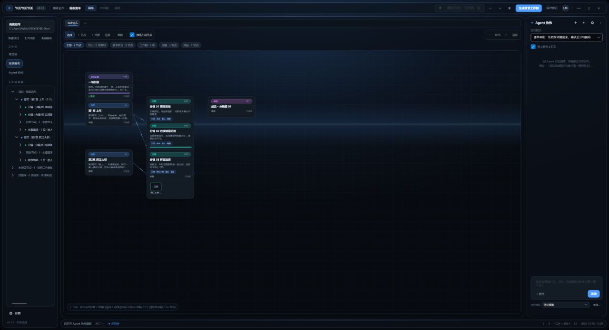
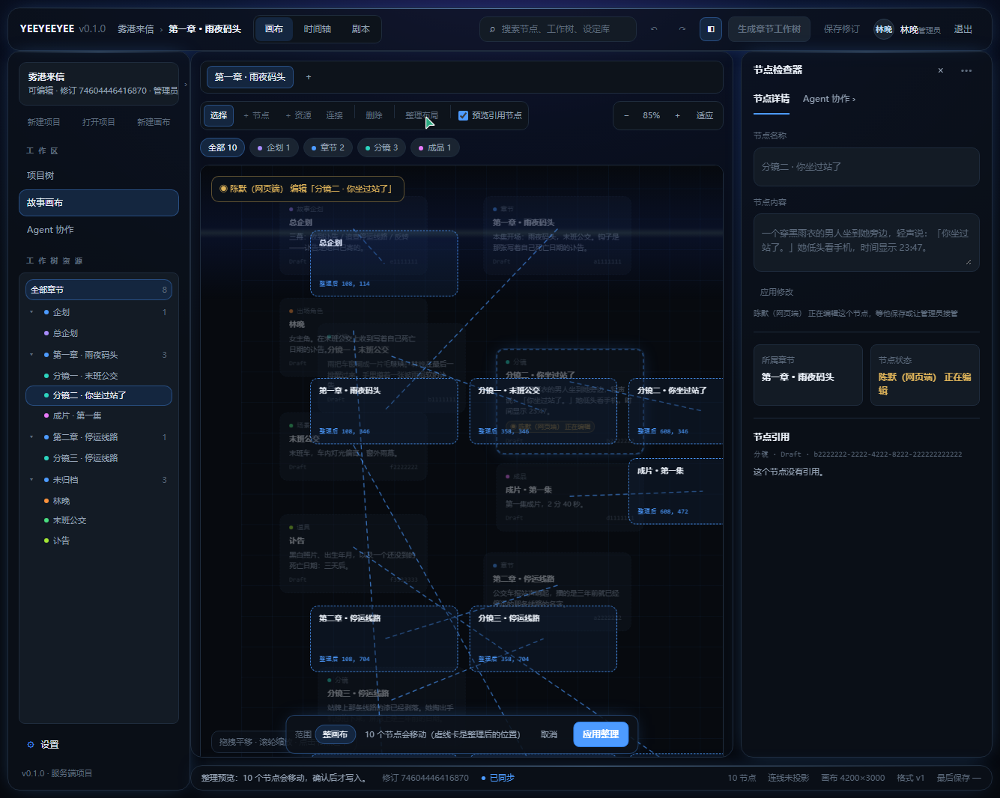

# YEEYEEYEE

> 面向 AI 创作的 Windows 桌面工作区与 Web 协作服务
>
> 在 AI 协助下，我们只需要 YES，一切交给 Agent。

[](https://github.com/Cybeta/YEEYEEYEE/actions/workflows/build.yml)
[](https://github.com/Cybeta/YEEYEEYEE/actions/workflows/docker-publish.yml)

YEEYEEYEE 是一个面向 AI 创作的项目工作区：把 **企划、章节、分镜、角色、场景、道具、图片、视频和成片** 放在同一个项目里。你可以在 Windows 桌面端使用完整工作区，也可以部署 Web 服务，在浏览器中与其他用户协作管理画布和素材。

当前源码版本为 **0.1.5.6**；可下载版本和发行状态以 [GitHub Releases](https://github.com/Cybeta/YEEYEEYEE/releases) 为准。

## 你可以用它做什么

- 用项目、章节和画布组织从企划到成片的创作流程。
- 用角色、场景、道具的设定图、变体和锁定版本作为分镜生成依据。
- 让 Agent 先理解你的对话，再把拟新增、修改或删除的节点和连线显示成画布虚影；确认并审批后才写入正式画布。
- 生成多张候选图，选择直接查看或使用开奖动画逐张揭晓，再把选中的图片收进分镜。
- 可选使用支持图片输入的视觉模型进行质量判档；判档失败、跳过判档都不会阻止查看和采用。
- 将已采用的分镜首帧用于视频任务，并把多个镜头按顺序拼接为成片。

## 界面预览

<p align="center">
  
  
</p>
<p align="center">
  
  
</p>

上面的 Agent 与画布截图展示的是预览层：虚影只代表待审批差异，不会直接改动正式节点。开奖和出图方式截图来自 Web 真实服务端验收；具体验证边界见 [Web 进度与待办](docs/Web进度与待办.md)。

## 快速开始

### 下载运行

从[最新发行版](https://github.com/Cybeta/YEEYEEYEE/releases/latest)下载 `win-x64.zip`，解压运行 `YEEYEEYEE.Desktop.Avalonia.exe`。需要 Windows、.NET 10 运行时和 Microsoft Edge WebView2 Runtime。建议放在可写目录，应用内更新需要替换程序文件。

`0.1.5.4` 及更早的便携安装如果程序旁有 `Projects`、配置或密钥，请先按 [Desktop 进度与待办](docs/Desktop进度与待办.md#0154-首次升级与手动迁移) 手动迁移，不要直接点应用内升级。

### 从源码运行

需要 Windows 和 .NET 10 SDK：

```powershell
dotnet build YEEYEEYEE.slnx
dotnet run --project YEEYEEYEE.Desktop.Avalonia
```

### 配置模型

在设置页填写聊天、图像和视频服务地址、模型和密钥。密钥按平台保存，不能把配置文件当成可跨机器迁移的凭据；加密不可用时应检查界面提示。判图质量需要支持图片输入的模型。也可接入本地或远程 ComfyUI。

## Desktop 与 Web

### Windows Desktop

桌面端适合单机创作和本地素材管理，包含项目工作区、画布、Agent 对话、动作预览与审批、设定引用、图片/视频生成、ComfyUI 官方前端工作流导出、媒体预览和成片处理。Agent 的动作先以预览形式呈现，确认后才执行。

### Web 工作区

Web 端适合浏览器访问和多人协作，提供：

- 项目、画布、章节和节点管理，以及登录权限、在线名单、编辑租约和修订冲突检查。
- 持久聊天、流式回复、附件预览、受限技能调用和动作审批。
- Agent 节点差异虚影：新增、修改、删除的节点与连线先显示在画布上，审批后才提交正式画布。
- 节点出图候选批次、出图方式选择（Web 图片 API、本机 ComfyUI 或已安装工作流）、开奖动画和选择采用；采用后的附件在刷新项目后仍可读取。
- 可选质量判档。判档依赖支持图片输入的视觉模型，默认关闭；Web 裂纹卡不会自动重出，由用户自行决定是否重新生成。
- 管理员模型、媒体共享、技能和 API 格式工作流设置。ComfyUI UI 工作流需要先通过官方前端导出 API，后续调用使用保存的 API JSON。

Web 端的真实模型、浏览器视口和 mock 交互证据在 [Web 进度与待办](docs/Web进度与待办.md) 中分开记录。

## ComfyUI

桌面设置页粘贴 ComfyUI 首页地址并测试连接：

1. 递归读取工作流；API Prompt 格式直接读取。
2. UI 格式由桌面 `NativeWebView` 加载目标官方前端，通过 `app.loadGraphData()` 和 `app.graphToPrompt().output` 导出。
3. Windows 默认两个 FIFO worker 共享 WebView2 环境，各自独占页面；内存条件触发时降为单 worker。
4. 导出核对请求、worker、会话、原稿 SHA-256、图身份、节点注册和动态稳定性；失败/超时销毁页面，没有官方宿主不回退 Playwright 或旧转换规则。
5. 读取 `/object_info`，只绑定明确识别的参数，检查缺失输入、文件及无效选项。

Web 没有桌面官方前端宿主：UI 格式需先在官方前端导出 API。兼容性取决于目标实例节点包与资源；ComfyUI 视频时长沿用工作流，不承诺桌面秒数被发送。详见 [ComfyUI 接入说明](docs/notes-comfyui.md)。

## Web 服务

本地开发：

```powershell
npm.cmd --prefix YEEYEEYEE.Canvas ci
npm.cmd --prefix YEEYEEYEE.Canvas run build
dotnet run --project YEEYEEYEE.Web
```

源码开发默认 `http://localhost:5000`。Docker 部署有两种方式。

**使用 Docker Hub 镜像（推荐，部署机器不需要源码）**

镜像由 [`.github/workflows/docker-publish.yml`](.github/workflows/docker-publish.yml) 构建：`main` 分支上 Web 相关改动合并后自动构建并推送，发布 Release 或手动触发时也会构建。镜像仓库是 [yuqing09/yeeyeeyee-web](https://hub.docker.com/r/yuqing09/yeeyeeyee-web)：

- `yuqing09/yeeyeeyee-web:latest`：跟随 `main` 的最新可用版本
- `yuqing09/yeeyeeyee-web:0.1.5.5`：版本号取自桌面工程的 `<Version>`，同时发布 `0.1.5`、`0` 与 `sha-<提交>`

```powershell
docker pull yuqing09/yeeyeeyee-web:latest
docker run -d --name yeeeyee-web `
  -p 8080:8080 `
  -v yeeeyee-data:/data `
  -e YEEYEEYEE__SetupToken="<一次性初始化令牌>" `
  -e YEEYEEYEE__WebProjectsDirectory=/data/projects `
  -e YEEYEEYEE__AllowStandaloneWebScene=true `
  -e YEEYEEYEE__WebScenePath=/data/scene.json `
  yuqing09/yeeyeeyee-web:latest
```

首次打开 `http://<部署机器>:8080` 创建管理员。没有设置 `YEEYEEYEE__SetupToken` 时，程序会生成一次性令牌并写在 `/data/.setup-token`，可以这样读取：

```powershell
docker exec yeeeyee-web cat /data/.setup-token
```

容器以非 root 用户运行（镜像内 uid `1654`）；镜像已预建 `/data/projects`、`/data/config` 与 `/data/assets`，配置了 `YEEYEEYEE__WebProjectsDirectory` 时服务启动还会补建该父目录。使用宿主机目录挂载时，目录必须对容器用户可写。生产部署应放在反向代理与 HTTPS 之后，并在暴露公网前设置固定的初始化令牌。

**从源码构建（需要本机 Docker 与源码）**

```powershell
docker compose up -d --build
```

**数据与升级**

- 账号库、任务库、聊天库、素材、项目、配置与加密密钥都在 `/data` 卷。模型/媒体配置固定为 `/data/config/web-ai-config.json`，本机 AES-GCM 主密钥为 `/data/config/ai-key.bin`（权限 0600）；两者必须一起备份，否则已保存的密钥无法解密。升级前备份整个卷；换机器后 `config` 下的密钥缺失会导致已有模型/媒体密钥无法解密。
- 容器升级是“拉取新镜像 + 用同一个 `/data` 卷重建容器”，不是容器内的文件替换。ZIP 发行包里的 `install-web.ps1`、`upgrade-web.ps1`、`rollback-web.ps1` 与完整备份校验只适用于 Windows ZIP 布局，不适用于容器；容器部署请直接备份 `/data` 卷。
- 使用 compose 配合 Docker Hub 镜像时：

```powershell
$env:YEEYEEYEE_IMAGE = "yuqing09/yeeyeeyee-web:latest"
docker pull $env:YEEYEEYEE_IMAGE
docker compose up -d --no-build
```

- 健康检查地址为 `/health`；日志用 `docker logs -f yeeeyee-web`。当前发布工作流构建 `linux/amd64` 镜像。

Windows ZIP 使用独立的版本目录与固定 `data` 目录：解压后先运行 `install-web.ps1 -InstallRoot <安装目录> [-LegacyDataDir <旧目录>]` 完成首次安装/旧布局迁移，日常用 `start-web.ps1` 启动；升级用 `upgrade-web.ps1 -ZipPath <新包> [-ExpectedSha256 <哈希>]`，回滚用 `rollback-web.ps1`。数据恢复会丢失备份之后的写入，必须显式确认，并且只接受带完成记录且文件校验通过的备份。完整命令见包内 `README-WEB.txt`，边界见 [Web 进度与待办](docs/Web进度与待办.md)。

## 资产与媒体

分镜的角色、场景、道具需求分别为“未知 / 无需求 / 必要”。未知、需求与引用冲突、失效引用、指定版本或图片缺失、版本决策待确认阻断生成。必要参考不能取消、裁剪或降级，超限或来源不支持参考必须调整配置。

图像批次保存实际请求和引用指纹；每张候选提交前复核，采用时保留生成依据。视频使用已采用且依据有效的分镜首帧；候选图不算采用，确认需求不能补记旧产物依据。引用指纹为参考图片记录流式 SHA-256 字节哈希，同路径替换即使大小与修改时间不变也能检出；旧指纹没有内容基线时只比较结构，不追溯判定历史替换，也不改写已有依据。哈希只在出图提交、视频前置检查和自检等明确检查点计算，不在画布渲染或高频轮询中读取图片。

桌面视频单击原位播放，图片/视频双击打开应用内大窗；默认静音，按需创建并保持单活动播放器。封面由独立串行 WebView 解码，短于 1 秒取中点，其余取 0.5 秒；有界缓存与空闲释放。截图失败保留播放入口，音频使用系统播放器。

## 文档与验证

- [Web 进度与待办](docs/Web进度与待办.md)
- [Desktop 进度与待办](docs/Desktop进度与待办.md)
- [ComfyUI 接入说明](docs/notes-comfyui.md)
- [参考图与设定锁定](docs/spec-参考图与设定锁定.md)
- [出图开奖与判档](docs/notes-开奖与判档.md)
- [发布说明与历史版本](docs/发布说明.md)

两份分端文档分别记录已实现、自动测试、实机待验收与未完成。人物跨镜一致性、旧项目资产补齐、全库 ComfyUI 兼容性以及 MP4 完整音画同步仍未完成验收，不用离线通过替代效果验收。

```powershell
dotnet build YEEYEEYEE.slnx -c Release
dotnet run --project YEEYEEYEE.Agent.Tests -c Release --no-build
dotnet run --project YEEYEEYEE.Core.Tests -c Release --no-build
dotnet run --project YEEYEEYEE.Migration.Tests -c Release --no-build
dotnet run --project YEEYEEYEE.G6V1.Tests -c Release --no-build
dotnet run --project YEEYEEYEE.Web.Tests -c Release --no-build
npm.cmd --prefix YEEYEEYEE.Canvas test
npm.cmd --prefix YEEYEEYEE.Canvas run build
```

## 许可证

本项目采用 [MIT License](LICENSE) 发布，Copyright (c) 2026 Cybeta。你可以自由使用、修改、分发和商用，保留版权与许可声明即可。
